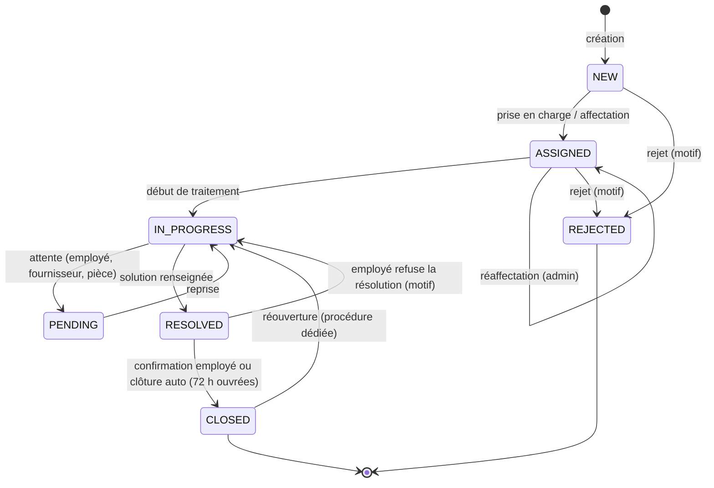

# 01 — Analyse fonctionnelle

> NexaDesk – IT Service Management · Phase 1 · Analyse et conception

## 1. Reformulation du besoin

NexaDesk est une **plateforme ITSM mono-entreprise** qui sert de point d'entrée unique entre les collaborateurs et le service informatique.

| Problème actuel (sans outil) | Réponse NexaDesk |
|---|---|
| Demandes par e-mail, téléphone, couloir → perdues ou non tracées | Tout passe par un **ticket** avec une référence unique et un historique |
| Personne ne sait qui traite quoi | **Affectation** explicite à un technicien, visible par tous les acteurs |
| Urgences noyées dans le flux | **Priorités** + **SLA** avec échéances calculées et alertes |
| Pas de visibilité sur la performance | **Dashboards** et **rapports** calculés à partir des données réelles |
| Problèmes récurrents résolus plusieurs fois | **Base de connaissances** + **détection d'incidents similaires** |
| Matériel non lié aux pannes | **Inventaire des équipements** relié aux tickets |

**Périmètre retenu :** une seule organisation, sans multi-tenant. Ce choix est volontaire : le multi-tenant multiplierait la complexité (isolation des données, configuration SLA par client) sans rien montrer de plus sur les compétences visées. L'architecture le permettrait plus tard en ajoutant un `organization_id`.

## 2. Acteurs

| Rôle | Description | Volume de démo |
|---|---|---|
| `EMPLOYEE` | Collaborateur qui signale un problème ou fait une demande | 15 |
| `TECHNICIAN` | Membre du support, avec une ou plusieurs **spécialités** (catégories) | 5 |
| `ADMIN` | Responsable du service IT : supervision, configuration, affectation | 1 |

Un utilisateur a **un seul rôle**. Un admin qui veut aussi traiter des tickets le fait avec ses droits d'admin (qui incluent ceux du technicien sur les tickets).

## 3. Matrice des permissions

Légende : ✅ autorisé · 🔒 restreint (voir condition) · ❌ interdit. **Toutes ces règles sont appliquées côté backend** (Spring Security + vérifications dans les services). Les guards Angular ne font que masquer la navigation.

### 3.1 Tickets

| Action | EMPLOYEE | TECHNICIAN | ADMIN |
|---|---|---|---|
| Créer un ticket | ✅ (pour lui-même) | ✅ (pour lui ou pour un employé) | ✅ (pour n'importe qui) |
| Lister les tickets | 🔒 les siens | 🔒 assignés à lui + non assignés de ses spécialités | ✅ tous |
| Voir le détail | 🔒 les siens | 🔒 assignés à lui, non assignés de ses spécialités, ou déjà traités par lui | ✅ |
| Modifier titre / description / pièces jointes | 🔒 les siens, statut `NEW` uniquement | 🔒 tickets assignés à lui | ✅ (sauf `CLOSED`) |
| Changer la catégorie ou la priorité | ❌ | 🔒 tickets assignés à lui (motif obligatoire) | ✅ |
| Prendre en charge (auto-affectation) | ❌ | 🔒 ticket `NEW` non assigné d'une de ses spécialités | ✅ |
| Affecter / réaffecter | ❌ | ❌ | ✅ |
| Changer le statut | 🔒 confirmer / refuser la résolution, rouvrir | 🔒 selon le workflow, tickets assignés à lui | ✅ selon le workflow |
| Rejeter (`REJECTED`) | ❌ | 🔒 tickets assignés à lui, motif obligatoire | ✅ motif obligatoire |
| Commentaire public | 🔒 ses tickets | 🔒 tickets accessibles | ✅ |
| Commentaire interne | ❌ (et invisibles pour lui) | ✅ | ✅ |
| Évaluer le support | 🔒 ses tickets `RESOLVED`/`CLOSED`, une seule fois | ❌ | ❌ |

### 3.2 Autres modules

| Action | EMPLOYEE | TECHNICIAN | ADMIN |
|---|---|---|---|
| Interventions (diagnostic, solution, temps passé) | ❌ (voit uniquement la solution publiée) | 🔒 tickets assignés à lui | ✅ |
| Gestion des utilisateurs | ❌ | ❌ | ✅ |
| Catégories, priorités, règles SLA, calendrier ouvré | ❌ (lecture des catégories) | ❌ (lecture) | ✅ |
| Équipements | 🔒 lecture de ceux qui lui sont affectés | ✅ lecture, mise à jour de l'état | ✅ CRUD |
| Dashboard | 🔒 personnel | 🔒 personnel | ✅ global |
| Rapports + exports | ❌ | 🔒 ses statistiques | ✅ |
| Journal d'audit | ❌ | ❌ | ✅ |
| Base de connaissances | 🔒 lecture des articles publiés | ✅ lecture + rédaction de brouillons | ✅ + publication |
| Assistant IA | ✅ | ✅ | ✅ |

## 4. Workflow des tickets

### 4.1 Machine à états



### 4.2 Table des transitions autorisées

Cette table est implémentée **une seule fois** dans le backend (`TicketWorkflow`) : chaque transition est une entrée `(from, to, rôles autorisés, préconditions)`. Le frontend interroge `GET /api/tickets/{id}/allowed-transitions` pour savoir quels boutons afficher. Il n'y a donc **aucune duplication de règle** côté Angular.

| De → Vers | Qui | Préconditions | Effets de bord |
|---|---|---|---|
| `NEW → ASSIGNED` | Technicien (soi-même), Admin | Technicien actif ; spécialité correspondant à la catégorie (sauf admin) | Notification à l'employé et au technicien |
| `NEW → REJECTED` | Admin | Motif obligatoire (doublon, hors périmètre, demande invalide) | Notification à l'employé |
| `ASSIGNED → ASSIGNED` | Admin | Nouveau technicien ≠ actuel | Historique (ancien → nouveau), notifications aux deux techniciens |
| `ASSIGNED → IN_PROGRESS` | Technicien assigné, Admin | — | **Première réponse SLA** enregistrée si ce n'est pas déjà fait |
| `ASSIGNED → REJECTED` | Technicien assigné, Admin | Motif obligatoire | Notification à l'employé |
| `IN_PROGRESS → PENDING` | Technicien assigné, Admin | Motif d'attente obligatoire (`WAITING_USER`, `WAITING_VENDOR`, `WAITING_PART`) | **Pause du chrono SLA de résolution** |
| `PENDING → IN_PROGRESS` | Technicien assigné, Admin ; automatique si l'employé répond pendant `WAITING_USER` | — | Reprise du SLA : l'échéance est décalée du temps de pause ouvré |
| `IN_PROGRESS → RESOLVED` | Technicien assigné, Admin | Au moins une intervention avec une **solution** renseignée | Horodatage `resolved_at`, contrôle du SLA, notification à l'employé |
| `RESOLVED → CLOSED` | Employé demandeur (confirmation), Admin, Système (clôture auto) | — | Invitation à l'évaluation (feedback) |
| `RESOLVED → IN_PROGRESS` | Employé demandeur | Motif obligatoire | Le SLA de résolution reprend (il n'est pas remis à zéro) |
| `CLOSED → IN_PROGRESS` | Employé demandeur (≤ 7 jours après clôture), Admin (sans limite) | Motif obligatoire | `reopen_count++`, retour au dernier technicien, notification |

### 4.3 Règles métier détaillées

| # | Règle | Justification |
|---|---|---|
| RM-01 | La référence est générée par le serveur : `INC-AAAA-NNNN` pour un incident, `REQ-AAAA-NNNN` pour une demande de service. Le compteur repart à 1 chaque année et par type. | Lisibilité métier ; un compteur par type évite les « trous » entre les deux séries |
| RM-02 | Le compteur est incrémenté sous **verrou pessimiste** (`SELECT … FOR UPDATE` sur `ticket_reference_counter`) | Garantit l'unicité même avec des créations concurrentes. Une contrainte `UNIQUE` sur `reference` sert de filet de sécurité |
| RM-03 | La priorité est proposée selon une **matrice Impact × Urgence** (ITIL) ; l'employé choisit impact et urgence, pas directement « Critical » | Évite que tout le monde déclare « Critical ». L'admin et le technicien peuvent corriger avec un motif tracé |
| RM-04 | Un employé ne modifie son ticket qu'en statut `NEW`. Ensuite, il communique par commentaires. | Le technicien ne doit pas voir le besoin changer pendant qu'il travaille |
| RM-05 | Un technicien ne peut prendre que les tickets `NEW` non assignés de ses spécialités | Évite qu'un technicien réseau prenne un ticket de comptabilité logicielle |
| RM-06 | Un ticket `CLOSED` ou `REJECTED` est en **lecture seule** ; seul l'endpoint de réouverture peut le modifier | Exigence du cahier des charges, intégrité des statistiques |
| RM-07 | Passer en `RESOLVED` exige une solution documentée | Alimente la base de connaissances et les suggestions IA |
| RM-08 | Un ticket `RESOLVED` sans réponse de l'employé est clôturé automatiquement après **72 h ouvrées** (configurable) | Évite les tickets « résolus » indéfiniment |
| RM-09 | Les commentaires internes ne sont **jamais** renvoyés par l'API à un `EMPLOYEE` (filtrage dans la requête, pas dans Angular) | Sécurité : un filtrage côté client fuirait les données dans la réponse HTTP |
| RM-10 | Une évaluation par ticket (1 à 5 étoiles + commentaire), uniquement par le demandeur | Mesure de la satisfaction fiable |
| RM-11 | Toute modification de statut, de priorité, de catégorie, d'affectation, de titre ou de description crée une entrée `ticket_history` (ancienne / nouvelle valeur) | Traçabilité exigée |
| RM-12 | Un utilisateur n'est jamais supprimé physiquement : il est **désactivé**. Un compte désactivé ne peut plus se connecter ; ses tickets restent consultables. | Intégrité référentielle et historique |
| RM-13 | Désactiver un technicien qui a des tickets ouverts est **bloqué** tant que l'admin ne les a pas réaffectés (l'API renvoie la liste des tickets concernés) | Aucun ticket orphelin |
| RM-14 | Un ticket peut être lié à **un** équipement ; un employé ne peut choisir que les équipements qui lui sont affectés | Cohérence de l'inventaire |
| RM-15 | Les pièces jointes : 10 Mo maximum par fichier, 5 fichiers par ticket, types autorisés : PNG, JPG, PDF, TXT, LOG, DOCX, XLSX (vérifiés par signature binaire, pas seulement par l'extension) | Sécurité des uploads |
| RM-16 | Optimistic locking (`@Version`) sur le ticket : deux techniciens qui modifient le même ticket simultanément → le second reçoit `409 Conflict` | Pas d'écrasement silencieux |

## 5. SLA — Fonctionnement du calcul

### 5.1 Configuration (modifiable par l'admin)

| Priorité | 1ʳᵉ réponse | Résolution | Horaires |
|---|---|---|---|
| `CRITICAL` | 15 min | 2 h | **24/7** (horloge calendaire) |
| `HIGH` | 1 h | 8 h | Heures ouvrées |
| `MEDIUM` | 4 h | 24 h | Heures ouvrées |
| `LOW` | 8 h | 48 h | Heures ouvrées |

**Calendrier ouvré** (configurable) : fuseau horaire de l'entreprise (ex. `Europe/Paris`), jours ouvrés (lundi → vendredi), plage horaire (08:00 → 18:00), plus une table de **jours fériés**.

> Les durées « ouvrées » sont des minutes **comptées uniquement pendant les heures ouvrées**. « 24 h ouvrées » avec une journée de 10 h représente donc environ 2,4 jours ouvrés. C'est la convention des outils ITSM du marché ; elle est affichée dans l'interface (« 24 h ouvrées ») pour éviter toute ambiguïté.

### 5.2 Ce qui est mesuré

| Mesure | Début | Fin | Pause |
|---|---|---|---|
| **Première réponse** | `created_at` | Premier passage en `IN_PROGRESS` **ou** premier commentaire public d'un technicien | Aucune |
| **Résolution** | `created_at` | Passage en `RESOLVED` | Pendant `PENDING`, et après une réouverture (la période où le ticket était fermé n'est pas comptée) |

### 5.3 Algorithme

```
addBusinessMinutes(start, minutes, calendar):
    si la règle est 24/7 → retourner start + minutes
    cursor ← start ramené au prochain instant ouvré
    restant ← minutes
    tant que restant > 0 :
        finDePlage ← fin de la plage ouvrée du jour de cursor
        disponible ← minutes entre cursor et finDePlage
        si disponible ≥ restant → retourner cursor + restant
        restant ← restant − disponible
        cursor ← début de la prochaine plage ouvrée (en sautant week-ends et jours fériés)
```

- **À la création :** `first_response_due_at = addBusinessMinutes(created_at, slaResponse)` et `resolution_due_at = addBusinessMinutes(created_at, slaResolution)`.
- **En passant en `PENDING` :** on enregistre `sla_paused_at`.
- **À la reprise :** `pausedBusiness = businessMinutesBetween(sla_paused_at, now)` ; on cumule dans `sla_paused_minutes` et on recalcule `resolution_due_at = addBusinessMinutes(resolution_due_at, pausedBusiness)`.
- **Changement de priorité :** les échéances sont recalculées depuis `created_at` avec la nouvelle règle, en conservant les pauses cumulées. La modification est tracée.
- Tous les calculs se font en `java.time` avec un `ZoneId` explicite (`ZonedDateTime`), et les dates sont stockées en `TIMESTAMPTZ`. Les changements d'heure été/hiver sont donc gérés correctement.
- Le service reçoit un `java.time.Clock` injecté, ce qui rend le calcul **testable de façon déterministe** (on fige l'heure dans les tests).

### 5.4 États SLA affichés

| État | Condition | Couleur |
|---|---|---|
| `ON_TRACK` | Moins de 75 % du temps consommé | Vert |
| `AT_RISK` | Au moins 75 % consommé (seuil configurable) | Orange |
| `BREACHED` | Échéance dépassée et ticket non résolu | Rouge |
| `PAUSED` | Ticket en `PENDING` | Gris |
| `MET` / `MISSED` | Ticket résolu avant / après l'échéance | Vert / rouge (historique) |

Un **job planifié** (`@Scheduled`, toutes les minutes) détecte les passages `AT_RISK` et `BREACHED` et envoie **une seule** notification par seuil (colonnes `sla_warning_sent_at` et `sla_breach_sent_at`). Le temps restant affiché en direct est calculé côté Angular à partir de l'échéance renvoyée par l'API. Le décompte se fait côté client ; la règle, elle, est calculée côté serveur.

**Taux de respect SLA** = tickets résolus dans les temps / tickets résolus sur la période, calculé séparément pour la première réponse et pour la résolution.

## 6. Notifications temps réel

| Événement | Destinataires |
|---|---|
| Ticket créé | Admin + techniciens ayant la spécialité correspondante |
| Ticket assigné / réaffecté | Technicien assigné (et l'ancien), employé demandeur |
| Statut modifié | Employé demandeur (+ technicien si le changement vient de l'admin ou de l'employé) |
| Commentaire public d'un technicien | Employé demandeur |
| Commentaire de l'employé | Technicien assigné |
| SLA `AT_RISK` | Technicien assigné (ou admin si le ticket n'est pas assigné) |
| SLA `BREACHED` | Technicien assigné + admin |
| Ticket résolu | Employé demandeur (avec action « Confirmer / Refuser ») |
| Résolution confirmée / refusée | Technicien assigné |

**Flux technique :** le service métier publie un *domain event* Spring (`TicketAssignedEvent`, etc.) → un `@TransactionalEventListener(phase = AFTER_COMMIT)` persiste la notification puis la pousse sur `/user/queue/notifications` via `SimpMessagingTemplate`. **Pourquoi AFTER_COMMIT ?** On n'envoie jamais de notification pour une transaction qui serait annulée ensuite.

## 7. Fonctionnalités IA

**Principe d'honnêteté :** l'application fonctionne entièrement sans IA. Chaque réponse IA porte un champ `source` (`LLM`, `HEURISTIC` ou `DISABLED`), et l'UI affiche un badge explicite (« Suggestion IA — modèle connecté » ou « Mode démonstration — heuristique locale, sans modèle IA »).

| Fonction | Mode LLM (clé configurée) | Mode heuristique (par défaut, gratuit) |
|---|---|---|
| Classification catégorie + priorité | Prompt structuré avec la liste des catégories, réponse JSON validée | Score par mots-clés définis sur chaque catégorie, plus des indicateurs d'urgence (« bloqué », « tout le service », « production ») |
| Résumé d'historique | Résumé généré à partir des commentaires et de l'historique | Résumé **extractif** : statut, durée, dernières actions, solution. Clairement libellé « résumé automatique (non IA) » |
| Suggestion de résolution | Le LLM reformule les solutions des tickets similaires et des articles | Liste brute des solutions des tickets similaires et des articles les plus pertinents |
| Assistant IT | Conversation alimentée par les articles de la base de connaissances (RAG simple) | Recherche plein texte dans la base de connaissances, résultats présentés comme des articles et non comme une réponse rédigée |
| Incidents similaires | **Toujours actif, sans IA** : recherche plein texte PostgreSQL (`tsvector`, `ts_rank`) combinée à la similarité trigramme (`pg_trgm`) sur titre et description | idem |

La détection de similarité est **réellement fonctionnelle** sans API payante, grâce à PostgreSQL. C'est un bon argument en entretien : on utilise la bonne technologie au bon endroit.

## 8. Données de démonstration

Activées par le profil Spring `demo` (jamais en production) :

- 1 admin, 5 techniciens avec des spécialités (Réseau, Matériel, Logiciels, Comptes & accès, Messagerie), 15 employés répartis dans 5 départements.
- 8 catégories / 25 sous-catégories, 4 priorités, 4 règles SLA, un calendrier ouvré et des jours fériés.
- **≥ 45 tickets** répartis sur les 6 derniers mois, dans tous les statuts, avec des SLA respectés, à risque et dépassés.
- Commentaires (publics et internes), interventions avec temps passé, historiques, notifications, évaluations, 10 équipements, 12 articles de base de connaissances.
- **Les dates sont générées relativement à la date de démarrage.** Le dashboard paraît donc toujours vivant : il y a toujours des tickets « en retard » et « à risque », quel que soit le jour de la démo.

### Comptes de démonstration

Mots de passe de test uniquement, documentés dans le README, hachés en BCrypt dans la base. Le domaine `.test` est réservé et n'est pas routable.

| Rôle | E-mail | Mot de passe |
|---|---|---|
| Admin | `admin@nexadesk.test` | `Demo@Admin2026` |
| Technicien | `tech.reseau@nexadesk.test` | `Demo@Tech2026` |
| Employé | `employe@nexadesk.test` | `Demo@User2026` |

La page de connexion affiche (uniquement en profil `demo`) trois boutons « Se connecter en tant que… » qui pré-remplissent le formulaire.
