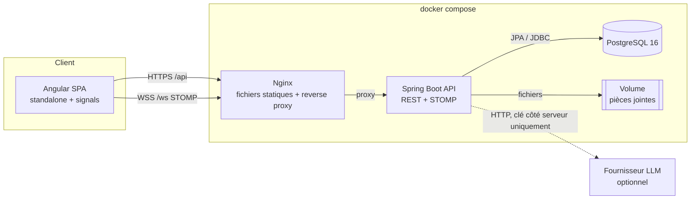
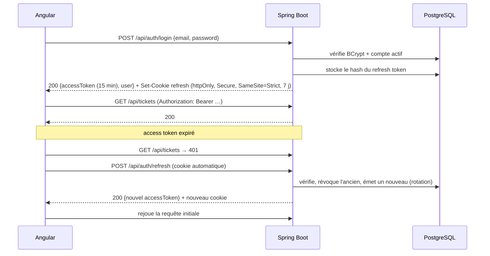
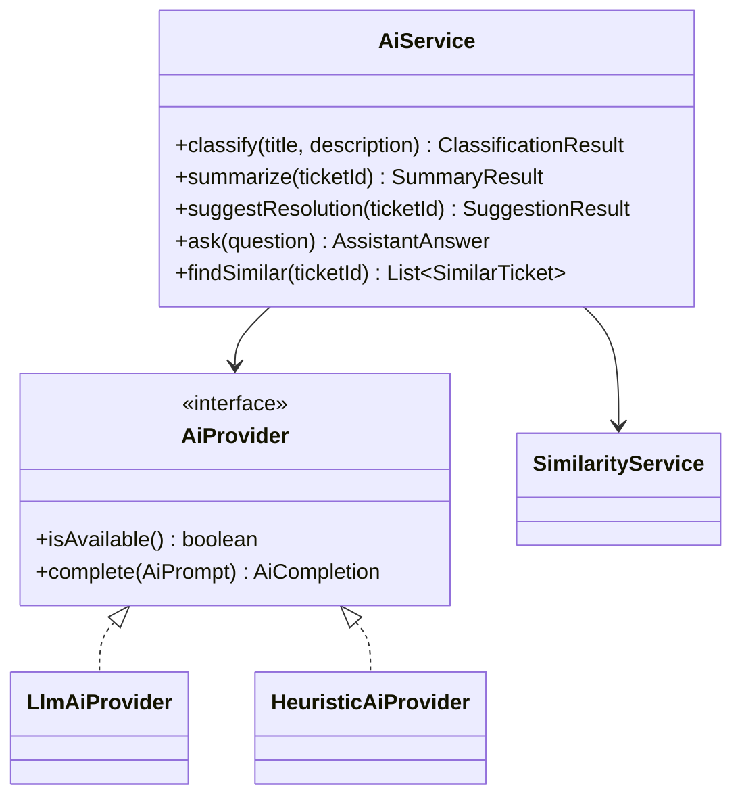

# 02 — Architecture technique

## 1. Vue d'ensemble



**Décision clé : un monolithe modulaire, pas des microservices.**
Une équipe, un domaine métier cohérent et un déploiement unique : les microservices ajouteraient du réseau, de la cohérence éventuelle et de l'orchestration sans aucun bénéfice ici. Le code est en revanche découpé **par fonctionnalité** (package-by-feature), avec des dépendances contrôlées entre modules. On pourrait donc extraire un module plus tard (par exemple `notification`).

**Même origine en production :** Nginx sert Angular et relaie `/api` et `/ws` vers Spring Boot. Il n'y a donc pas de CORS à ouvrir en production, et le cookie du refresh token reste en `SameSite=Strict`. En développement, le proxy du serveur de dev Angular (`proxy.conf.json`) reproduit ce comportement.

## 2. Versions cibles

Les versions exactes (patch) seront vérifiées et figées en Phase 2, au moment de l'initialisation.

| Composant | Version | Raison |
|---|---|---|
| Java | **21 LTS** | Compatible avec l'exigence « 17 ou LTS compatible » ; records, pattern matching, virtual threads disponibles |
| Spring Boot | **3.5.x** (dernière ligne 3.x) | Exigence « Spring Boot 3 » ; ligne la plus récente et maintenue |
| PostgreSQL | 16 | Stable, `pg_trgm` et full-text natifs |
| Flyway | inclus via Spring Boot | Migrations versionnées (voir § 3.4) |
| springdoc-openapi | 2.8.x | Swagger UI compatible avec Spring Boot 3.5 |
| MapStruct | 1.6.x | Mapping entité ↔ DTO généré à la compilation |
| Angular | **dernière version stable** (CLI `ng new`) | Standalone par défaut, signals, nouveau control flow `@if/@for` |
| Chart.js + ng2-charts | dernières versions compatibles | Graphiques interactifs, bon support d'Angular |
| Angular CDK | même version majeure qu'Angular | Drag & drop (Kanban), overlays, a11y, sans le style Material |
| lucide-angular | dernière | Icônes cohérentes (exigence) |
| @stomp/rx-stomp | dernière | Client STOMP exposé en Observables RxJS |

## 3. Backend — Spring Boot

### 3.1 Organisation des packages

```
com.nexadesk
├── NexaDeskApplication.java
├── config          # OpenAPI, WebSocket, Jackson, Scheduling, Clock, propriétés typées
├── security        # SecurityFilterChain, JwtService, JwtAuthFilter, StompAuthInterceptor,
│                   # CurrentUser (accès à l'utilisateur courant), handlers 401/403
├── auth            # login, refresh, logout, me — RefreshToken entity
├── user            # User, Role, Department, gestion admin, profil
├── category        # TicketCategory, TicketSubCategory, Priority
├── ticket          # Ticket, workflow, comments, attachments, history, feedback, références
│   ├── workflow    # TicketStatus, TicketWorkflow (table des transitions), TransitionRule
│   ├── comment
│   ├── attachment  # FileStorageService (interface) + LocalFileStorageService
│   └── feedback
├── intervention    # Intervention (diagnostic, solution, temps passé)
├── sla             # SlaConfiguration, BusinessCalendar, Holiday, SlaCalculator, SlaMonitorJob
├── notification    # Notification, NotificationService, listeners d'événements, push STOMP
├── equipment       # Equipment, historique d'affectation
├── knowledge       # KnowledgeArticle
├── dashboard       # requêtes agrégées par rôle
├── reporting       # rapports, exports PDF (OpenPDF) et Excel (Apache POI)
├── ai              # AiService, AiProvider (interface), HeuristicAiProvider, LlmAiProvider
├── audit           # AuditLog, AuditService, @Audited (aspect)
├── common          # BaseEntity, PageResponse<T>, utilitaires, événements de domaine
└── exception       # GlobalExceptionHandler (@RestControllerAdvice), exceptions métier
```

Chaque module contient au besoin : `XxxController`, `XxxService`, `XxxRepository`, `Xxx` (entité), `dto/` (records), `XxxMapper` (MapStruct) et des exceptions spécifiques.

### 3.2 Couches et responsabilités

| Couche | Fait | Ne fait pas |
|---|---|---|
| **Controller** | Mapping HTTP, `@Valid`, `@PreAuthorize` sur le rôle, codes de retour, annotations OpenAPI | Aucune règle métier, aucun accès direct au repository |
| **Service** | Règles métier, contrôle d'accès **à la ressource** (« ce ticket est-il le sien ? »), transactions, publication d'événements | Pas de connaissance de HTTP |
| **Repository** | Spring Data JPA, `Specification` pour les filtres combinés, projections pour les dashboards | Pas de logique |
| **Mapper** | Entité ↔ DTO | Pas d'accès à la base |

**Deux niveaux de sécurité :**
1. **Rôle** : `@PreAuthorize("hasRole('ADMIN')")` sur le controller ;
2. **Propriété de la ressource** : dans le service (`TicketAccessPolicy.assertCanView(ticket, currentUser)`) et, pour les listes, directement dans la `Specification`. Un employé ne peut donc jamais récupérer le ticket d'un autre, même en devinant son ID. La réponse est alors `404`, et non `403`, pour ne pas révéler l'existence de la ressource.

### 3.3 Authentification JWT



| Choix | Pourquoi |
|---|---|
| Access token court (15 min) **en mémoire** (signal Angular), pas dans `localStorage` | Un script injecté (XSS) ne peut pas le lire depuis le stockage persistant |
| Refresh token **opaque** en cookie `httpOnly`, stocké **haché** en base | Inaccessible au JavaScript ; révocable (déconnexion, désactivation du compte) |
| **Rotation** à chaque refresh, avec détection de réutilisation | Si un ancien refresh token est réutilisé (vol probable), toute la famille de tokens est révoquée |
| Signature HS256, secret ≥ 256 bits fourni par variable d'environnement | Pas de secret dans Git |
| `SecurityFilterChain` stateless, CSRF désactivé pour `/api/**` sauf `/api/auth/refresh` (protégé par `SameSite=Strict` + vérification de l'origine) | Le Bearer n'est pas envoyé automatiquement par le navigateur, donc pas de CSRF possible ; le seul endpoint basé sur un cookie est protégé spécifiquement |
| Les erreurs 401 et 403 renvoient un JSON `ProblemDetail` (RFC 9457) | Format d'erreur standard, homogène |
| Limitation des tentatives de connexion (5 échecs → blocage de 15 min par compte) | Protection contre la force brute |

**WebSocket :** le client STOMP envoie `Authorization: Bearer …` dans la trame `CONNECT`. Un `ChannelInterceptor` valide le JWT et attache le `Principal`, puis les notifications sont envoyées sur `/user/queue/notifications`. Spring résout automatiquement la destination propre à chaque utilisateur.

### 3.4 Persistance

- **Flyway** gère le schéma (`V1__init.sql`, …) et Hibernate est en `ddl-auto=validate`. **Pourquoi ?** Le schéma est versionné, relu et reproductible, et Hibernate vérifie au démarrage que les entités correspondent. Avec `update`, des changements implicites et non traçables arriveraient en production.
- Les données de démo sont chargées par un `DemoDataSeeder` (Java, profil `demo`) et non par une migration Flyway : elles dépendent de la date courante (voir l'analyse fonctionnelle, § 8) et ne doivent **jamais** atteindre la production.
- `open-in-view=false` : pas de lazy loading caché dans la couche web ; les `@EntityGraph` sont déclarés explicitement là où on en a besoin, ce qui évite les problèmes N+1.
- Pagination et tri côté serveur via `Pageable`, avec une **liste blanche** des champs triables (pas de tri sur une propriété arbitraire envoyée par le client).

### 3.5 Gestion des erreurs

`GlobalExceptionHandler` convertit les exceptions en `ProblemDetail` :

| Exception | HTTP |
|---|---|
| `MethodArgumentNotValidException` (Bean Validation) | 400, avec la liste `errors[{field, message}]` |
| `ResourceNotFoundException` | 404 |
| `AccessDeniedException` | 403 |
| `InvalidTransitionException`, `BusinessRuleException` | 409 ou 422 avec un `code` métier (`TICKET_CLOSED`, `TRANSITION_NOT_ALLOWED`…) |
| `ObjectOptimisticLockingFailureException` | 409 (« Ce ticket a été modifié par quelqu'un d'autre ») |
| `MaxUploadSizeExceededException` | 413 |
| Toute autre exception | 500, message générique, stack trace uniquement dans les logs, avec un `traceId` |

### 3.6 Fichiers

Interface `FileStorageService` avec l'implémentation `LocalFileStorageService` (volume Docker). Elle pourra être remplacée par S3 sans modifier le reste du code.
Nom de stockage = UUID, sans le nom original (protection contre le path traversal). Le type MIME est détecté par **Apache Tika** sur le contenu réel. Le téléchargement passe uniquement par `GET /api/tickets/{id}/attachments/{aid}`, après vérification des droits, avec `Content-Disposition: attachment`. Aucun fichier n'est servi en statique.

### 3.7 Journalisation et audit

- Logs SLF4J/Logback ; un `traceId` par requête (MDC) est renvoyé dans l'en-tête `X-Trace-Id` et inclus dans les erreurs 500.
- `ticket_history` : la **timeline métier** d'un ticket, visible dans l'UI par les acteurs du ticket.
- `audit_log` : le **journal de sécurité et d'administration**, consultable uniquement par l'admin (connexions, échecs de connexion, changements de rôle, désactivations, modifications de configuration SLA, et une copie des actions importantes sur les tickets).
  Les deux sont distincts parce qu'ils n'ont ni le même public, ni la même durée de conservation, ni le même niveau de détail.

### 3.8 Module IA



- `nexadesk.ai.mode = disabled | heuristic | llm` (par défaut `heuristic`). Le bean `AiProvider` est choisi au démarrage via `@ConditionalOnProperty`.
- En mode `llm`, la clé est lue depuis une **variable d'environnement côté serveur**. Si elle est absente, on revient automatiquement en mode `heuristic` avec un warning dans les logs.
- Le fournisseur LLM précis (API Anthropic, ou un endpoint compatible OpenAI comme Ollama en local et gratuit) sera choisi en Phase 3. L'interface rend ce choix réversible.
- Les appels LLM ont un timeout (10 s), un rate limit par utilisateur et une validation stricte de la réponse JSON. En cas d'échec, on bascule sur l'heuristique.
- Seuls le titre, la description et les extraits de la base de connaissances sont envoyés au LLM : jamais d'e-mail ni de nom d'utilisateur (minimisation des données).

### 3.9 Tâches planifiées

| Job | Fréquence | Rôle |
|---|---|---|
| `SlaMonitorJob` | 1 min | Détecte `AT_RISK` et `BREACHED`, envoie les notifications (une seule fois par seuil) |
| `AutoCloseResolvedJob` | 15 min | Clôture les tickets `RESOLVED` depuis plus de 72 h ouvrées |
| `RefreshTokenCleanupJob` | quotidien | Purge les refresh tokens expirés |

## 4. Frontend — Angular

### 4.1 Structure

```
src/app
├── core
│   ├── auth            # AuthService (signals), token store en mémoire, refresh
│   ├── guards          # authGuard, roleGuard(...roles), guestGuard  (fonctionnels)
│   ├── interceptors    # authInterceptor, refreshInterceptor, errorInterceptor, loadingInterceptor
│   ├── services        # ApiService de base, WebSocketService (rx-stomp), ThemeService, ToastService
│   ├── models          # interfaces TypeScript alignées sur les DTO de l'API
│   └── config          # navigation par rôle, constantes
├── shared
│   ├── components      # sidebar, header, user-menu, notification-center, stat-card, data-table,
│   │                   # search-bar, filter-bar, status-badge, priority-badge, sla-indicator,
│   │                   # confirm-dialog, skeleton, empty-state, paginator, toast-container,
│   │                   # drawer, avatar, breadcrumbs, chart-card
│   ├── pipes           # relativeTime, duration, initials
│   └── directives      # autofocus, clickOutside, hasRole
├── features
│   ├── auth            # login
│   ├── dashboard       # admin-dashboard, technician-dashboard, employee-dashboard
│   ├── tickets         # list (table + kanban), detail (drawer + page), create/edit form, timeline
│   ├── interventions
│   ├── users
│   ├── equipment
│   ├── notifications   # page historique
│   ├── reports
│   ├── knowledge-base
│   ├── ai-assistant
│   ├── settings        # catégories, priorités, SLA, calendrier (admin)
│   ├── audit
│   └── profile
├── layouts
│   ├── app-shell       # layout authentifié unique (sidebar + header + router-outlet)
│   └── auth-layout     # layout de la page de connexion
└── app.routes.ts       # routes lazy loadées (loadComponent / loadChildren)
```

**Écart volontaire avec la structure suggérée :** un **seul** `app-shell`, et non trois layouts admin/technicien/employé. Les trois layouts seraient à 95 % identiques (même sidebar, même header) ; seule la navigation change. La navigation est donc une **configuration par rôle** (`NAV_ITEMS: Record<Role, NavItem[]>`). On évite ainsi de dupliquer du code (règle 5), et l'ajout d'un rôle se fait en une seule ligne. Les dashboards, eux, sont bien trois composants distincts, chargés selon le rôle.

### 4.2 Gestion de l'état

| Besoin | Outil | Pourquoi |
|---|---|---|
| Utilisateur connecté, rôle, thème, sidebar repliée, compteur de notifications non lues | **Signals** (`signal`, `computed`) dans des services `providedIn: 'root'` | État synchrone, lu dans beaucoup de templates, détection de changement fine |
| Appels HTTP, recherche avec `debounceTime`, annulation (`switchMap`), flux WebSocket | **RxJS** | Flux asynchrones et annulables : c'est exactement le rôle de RxJS |
| Pont entre les deux | `toSignal()` / `toObservable()` | On garde l'outil adapté à chaque cas |
| Filtres de la liste des tickets | Synchronisés avec les **query params** de l'URL | Une vue filtrée est partageable par lien et survit au rafraîchissement |

**Pas de NgRx :** pour cette taille d'application, des services + signals suffisent. NgRx ajouterait du code passe-partout sans réel bénéfice. C'est un choix argumenté, pas une lacune.

### 4.3 Interceptors

1. `authInterceptor` : ajoute le Bearer à toutes les requêtes `/api` sauf `/api/auth/*`.
2. `refreshInterceptor` : sur un 401, lance **un seul** refresh partagé (les requêtes concurrentes attendent le même `Observable`), puis rejoue la requête. Si le refresh échoue, déconnexion et redirection vers `/login?returnUrl=…`.
3. `errorInterceptor` : 403 → toast « Accès refusé » ; 409/422 → toast avec le message métier ; 0/5xx → toast générique avec le `traceId`. Les erreurs de validation 400 sont laissées au formulaire, qui les affiche sur les champs concernés.

### 4.4 Formulaires

Reactive Forms **typés** (`FormGroup<{ title: FormControl<string> … }>` via `NonNullableFormBuilder`), validateurs alignés sur la Bean Validation backend, messages d'erreur affichés au `blur` puis en direct, et erreurs 400 du serveur réinjectées dans les contrôles. Le bouton de soumission est désactivé pendant l'envoi pour éviter les doubles soumissions.

## 5. Stratégie de tests

| Niveau | Outils | Cible prioritaire |
|---|---|---|
| Unitaires backend | JUnit 5 + Mockito + AssertJ | `TicketWorkflow` (toutes les transitions, autorisées et interdites), `SlaCalculator` (week-ends, jours fériés, pause, changement d'heure, 24/7), `TicketAccessPolicy`, génération des références, `HeuristicAiProvider` |
| Controllers + sécurité | `@WebMvcTest` + `spring-security-test` (`@WithMockUser`, jwt()) | Chaque endpoint sensible testé avec les 3 rôles, ainsi qu'en anonyme (401) |
| Intégration | `@SpringBootTest` + **Testcontainers PostgreSQL** | Repositories, `Specification`, requêtes de dashboard, full-text / `pg_trgm`, concurrence sur les références |
| Frontend | Runner par défaut du CLI Angular + `HttpTestingController` | Services, guards, interceptors (refresh concurrent), formulaire de création, `status-badge`, `sla-indicator`, liste des tickets |
| Manuel / API | Collection Postman versionnée + Swagger UI | Démonstration et recette |

**Testcontainers plutôt que H2 :** les requêtes reposent sur des fonctionnalités propres à PostgreSQL (`pg_trgm`, `tsvector`, `date_trunc`, `TIMESTAMPTZ`), que H2 ne reproduit pas fidèlement. Un test qui passe sur H2 pourrait échouer en production.

## 6. Docker et environnements

| Fichier | Contenu |
|---|---|
| `backend/Dockerfile` | Build multi-stage (Maven → JRE 21 slim), utilisateur non root, healthcheck sur `/actuator/health` |
| `frontend/Dockerfile` | Build multi-stage (Node → Nginx alpine), `nginx.conf` avec fallback SPA et proxy `/api` + `/ws` (upgrade WebSocket) |
| `docker-compose.yml` | `postgres`, `backend`, `frontend` ; volumes `pgdata` et `uploads` ; `depends_on` avec healthcheck |
| `docker-compose.dev.yml` | PostgreSQL seul, exposé localement, pour développer avec `mvn spring-boot:run` et le serveur de dev Angular |
| `.env.example` | `POSTGRES_*`, `JWT_SECRET`, `APP_TIMEZONE`, `AI_MODE`, `AI_API_KEY` (vide), `SPRING_PROFILES_ACTIVE` |

Profils Spring : `dev` (logs verbeux, Swagger actif), `demo` (seeder actif), `prod` (Swagger désactivé ou protégé, cookie `Secure`, logs JSON). `.env` est dans le `.gitignore` ; seul `.env.example` est versionné.
