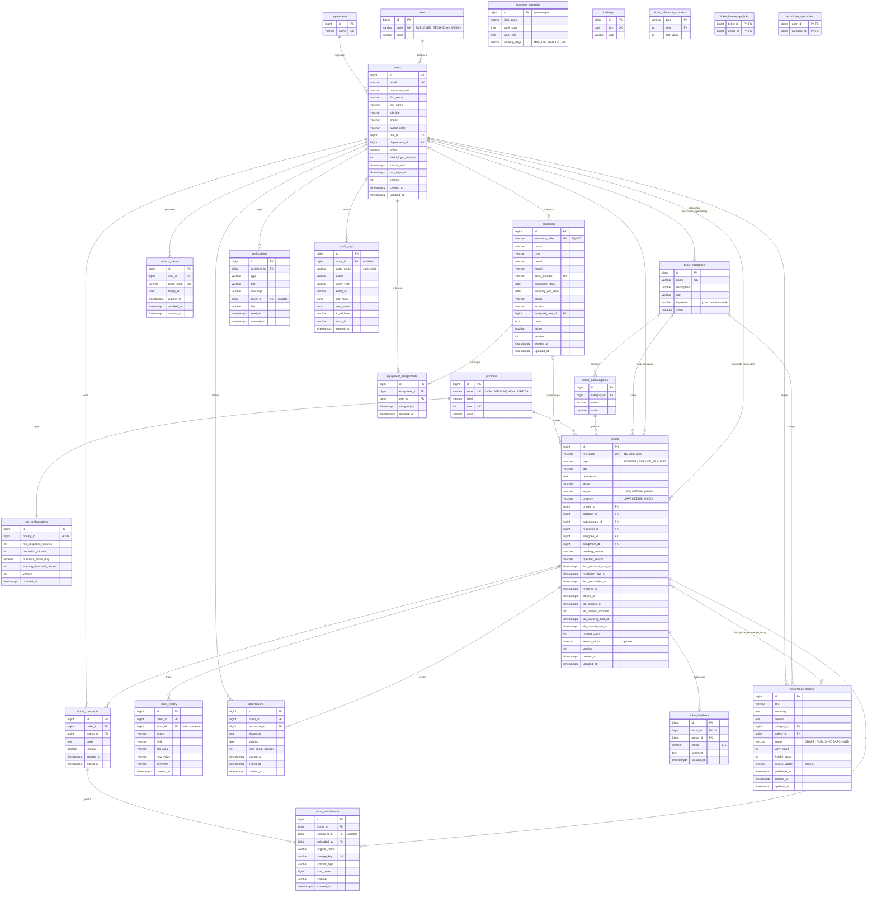

# 03 — Conception de la base de données (PostgreSQL)

## 1. Conventions

| Convention | Choix | Raison |
|---|---|---|
| Clés primaires | `BIGINT GENERATED ALWAYS AS IDENTITY` | Simple et performant ; l'identifiant métier exposé aux utilisateurs reste la `reference` |
| Nommage | `snake_case`, tables au pluriel | Convention PostgreSQL |
| Dates | `TIMESTAMPTZ` (UTC en base, conversion vers le fuseau de l'entreprise à l'affichage et pour le calcul SLA) | Aucune ambiguïté liée au fuseau ou au changement d'heure |
| Enums | `VARCHAR` + contrainte `CHECK`, mappés en `@Enumerated(EnumType.STRING)` | Lisible en base ; ajouter une valeur ne demande qu'une migration simple, contrairement au type `ENUM` de PostgreSQL |
| Colonnes d'audit | `created_at`, `updated_at` (via `@CreationTimestamp` / `@UpdateTimestamp`), plus `created_by` si utile | Présentes sur toutes les entités principales (`BaseEntity`) |
| Verrouillage optimiste | `version INT` sur `tickets`, `users`, `equipment`, `sla_configurations` | Détection des modifications concurrentes (409) |
| Suppression | Logique (`active = false`) pour les utilisateurs, catégories et équipements ; physique uniquement pour les pièces jointes d'un ticket encore `NEW` | Conservation de l'historique |

## 2. Diagramme entité-relation

> `business_calendar` et `holidays` ne sont reliés à aucune autre table : ce sont des tables de configuration lues par le `SlaCalculator`.

## 3. Explication des relations principales

| Relation | Type JPA | Explication |
|---|---|---|
| `User` → `Role` | `@ManyToOne` | Un rôle par utilisateur. `Role` est une table (et pas seulement un enum) pour pouvoir afficher un libellé et rester extensible ; son `code` est mappé sur un enum Java utilisé par Spring Security (`ROLE_ADMIN`…) |
| `User` ↔ `TicketCategory` (spécialités) | `@ManyToMany` via `technician_specialties` | Un technicien couvre plusieurs domaines, un domaine est couvert par plusieurs techniciens. C'est la base de la règle RM-05 et du routage des notifications « nouveau ticket » |
| `Ticket` → `User` (×2) | deux `@ManyToOne` : `requester` (obligatoire), `assignee` (optionnel) | Deux rôles distincts du même utilisateur dans le ticket |
| `Ticket` → `Priority` / `TicketCategory` / `TicketSubCategory` | `@ManyToOne` | Données de référence configurables. Une contrainte applicative vérifie que la sous-catégorie appartient bien à la catégorie |
| `Priority` → `SlaConfiguration` | `@OneToOne` | Exactement une règle SLA par priorité (`UNIQUE` sur `priority_id`) |
| `Ticket` → `Equipment` | `@ManyToOne` optionnel | « Un ticket peut être lié à un équipement » ; l'historique des incidents d'un équipement se calcule par requête sur `tickets.equipment_id` |
| `Ticket` → commentaires, pièces jointes, historique, interventions | `@OneToMany(mappedBy)`, chargement LAZY | Composition : ces éléments n'existent pas sans le ticket. Ils sont chargés par endpoint dédié et paginés, jamais tous d'un coup |
| `Ticket` → `TicketFeedback` | `@OneToOne` | Une seule évaluation par ticket (`UNIQUE ticket_id`) |
| `Ticket` ↔ `KnowledgeArticle` | `@ManyToMany` via `ticket_knowledge_links` | Un technicien rattache l'article qui a servi à résoudre le ticket. Cela alimente les suggestions et le compteur d'utilité de l'article |
| `Equipment` → `EquipmentAssignment` | `@OneToMany` | Historique de qui a détenu l'équipement ; `equipment.assigned_user_id` est l'affectation courante (dénormalisée pour des lectures simples) |
| `AuditLog` → `User` | `@ManyToOne` optionnel + `actor_email` copié | Le journal reste lisible même si l'utilisateur est renommé ; `jsonb` stocke des valeurs avant/après structurées |

## 4. Énumérations

| Enum | Valeurs |
|---|---|
| `TicketType` | `INCIDENT`, `SERVICE_REQUEST` |
| `TicketStatus` | `NEW`, `ASSIGNED`, `IN_PROGRESS`, `PENDING`, `RESOLVED`, `CLOSED`, `REJECTED` |
| `Impact`, `Urgency` | `LOW`, `MEDIUM`, `HIGH` |
| `PendingReason` | `WAITING_USER`, `WAITING_VENDOR`, `WAITING_PART`, `OTHER` |
| `HistoryAction` | `CREATED`, `UPDATED`, `ASSIGNED`, `REASSIGNED`, `STATUS_CHANGED`, `PRIORITY_CHANGED`, `CATEGORY_CHANGED`, `COMMENT_ADDED`, `ATTACHMENT_ADDED`, `INTERVENTION_ADDED`, `RESOLVED`, `CLOSED`, `REOPENED`, `REJECTED`, `FEEDBACK_ADDED`, `SLA_WARNING`, `SLA_BREACHED` |
| `NotificationType` | `TICKET_CREATED`, `TICKET_ASSIGNED`, `STATUS_CHANGED`, `NEW_COMMENT`, `SLA_WARNING`, `SLA_BREACHED`, `TICKET_RESOLVED`, `RESOLUTION_CONFIRMED`, `RESOLUTION_REJECTED` |
| `EquipmentType` | `LAPTOP`, `DESKTOP`, `MONITOR`, `PRINTER`, `KEYBOARD`, `MOUSE`, `SERVER`, `NETWORK`, `PHONE`, `OTHER` |
| `EquipmentStatus` | `IN_STOCK`, `IN_USE`, `IN_REPAIR`, `RETIRED` |
| `ArticleStatus` | `DRAFT`, `PUBLISHED`, `ARCHIVED` |

**Matrice Impact × Urgence → Priorité** (RM-03) :

| Impact \ Urgence | LOW | MEDIUM | HIGH |
|---|---|---|---|
| **HIGH** | MEDIUM | HIGH | CRITICAL |
| **MEDIUM** | LOW | MEDIUM | HIGH |
| **LOW** | LOW | LOW | MEDIUM |

## 5. Contraintes d'intégrité

- `users.email` : `UNIQUE`, stocké en minuscules (la normalisation est faite par le service).
- `tickets.reference` : `UNIQUE` ; `tickets.title` : `CHECK (char_length(title) BETWEEN 5 AND 150)`.
- `tickets.status`, `type`, `impact`, `urgency` : `CHECK (… IN (…))`.
- `CHECK (status <> 'REJECTED' OR rejection_reason IS NOT NULL)` et `CHECK (status <> 'PENDING' OR pending_reason IS NOT NULL)`.
- `CHECK (status NOT IN ('ASSIGNED','IN_PROGRESS','PENDING','RESOLVED') OR assignee_id IS NOT NULL)` : un ticket en cours a forcément un technicien.
- `ticket_feedback.rating` : `CHECK (rating BETWEEN 1 AND 5)`, `UNIQUE (ticket_id)`.
- `interventions.time_spent_minutes` : `CHECK (time_spent_minutes BETWEEN 0 AND 1440)`.
- `sla_configurations` : `CHECK (first_response_minutes > 0 AND resolution_minutes > first_response_minutes)` et `CHECK (warning_threshold_percent BETWEEN 50 AND 95)`.
- `ticket_subcategories` : `UNIQUE (category_id, name)`.
- `equipment.inventory_code`, `equipment.serial_number` : `UNIQUE`.
- Clés étrangères : `ON DELETE RESTRICT` par défaut (rien n'est supprimé en cascade par accident), sauf `ticket_knowledge_links` et `technician_specialties` en `ON DELETE CASCADE` (tables de liaison).

Les contraintes métier complexes (sous-catégorie appartenant à la catégorie, transitions du workflow) restent **dans le service Java**, où elles sont testées unitairement. Les `CHECK` en base sont un **filet de sécurité** : elles garantissent qu'aucun état incohérent ne peut être écrit, même par un bug.

## 6. Index

| Index | Usage |
|---|---|
| `tickets (status)`, `tickets (assignee_id, status)`, `tickets (requester_id, status)` | Listes filtrées et dashboards par rôle |
| `tickets (created_at DESC)` | Tri par défaut, évolution mensuelle |
| `tickets (resolution_due_at) WHERE status IN ('NEW','ASSIGNED','IN_PROGRESS')` (index partiel) | `SlaMonitorJob` : ne parcourt que les tickets actifs |
| `tickets (category_id)`, `tickets (priority_id)`, `tickets (equipment_id)` | Filtres et rapports |
| `GIN (search_vector)` sur `tickets` et `knowledge_articles` | Recherche plein texte (configuration `french`) |
| `GIN (title gin_trgm_ops)` sur `tickets` | Similarité trigramme et recherche tolérante aux fautes |
| `ticket_comments (ticket_id, created_at)`, `ticket_history (ticket_id, created_at)` | Timeline du ticket |
| `notifications (recipient_id, read_at, created_at DESC)` | Compteur de non lues et centre de notifications |
| `audit_logs (created_at DESC)`, `audit_logs (entity_type, entity_id)` | Consultation de l'audit |
| `refresh_tokens (token_hash)` (unique), `refresh_tokens (family_id)` | Refresh et révocation par famille |

`search_vector` est une colonne générée :
`GENERATED ALWAYS AS (setweight(to_tsvector('french', coalesce(title,'')), 'A') || setweight(to_tsvector('french', coalesce(description,'')), 'B')) STORED`.
Le titre pèse plus lourd que la description dans le classement des résultats.

## 7. DTO — principe

Aucune entité JPA ne sort d'un controller. Les DTO sont des **records Java** immuables, par exemple :

- `TicketSummaryDto` : liste et Kanban (référence, titre, statut, priorité, nom du demandeur, nom du technicien, état SLA, échéance) ;
- `TicketDetailDto` : vue détaillée, avec `allowedTransitions` calculées pour l'utilisateur courant ;
- `CreateTicketRequest`, `UpdateTicketRequest`, `ChangeStatusRequest`, `AssignTicketRequest` : requêtes validées (`@NotBlank`, `@Size`, `@NotNull`…) ;
- `PageResponse<T>` : `content`, `page`, `size`, `totalElements`, `totalPages`, pour un format de pagination stable et indépendant de Spring.

**Pourquoi ?** On contrôle exactement ce qui est exposé (jamais le `password_hash`, ni les commentaires internes pour un employé), l'API ne casse pas quand le modèle interne évolue, et on évite la sérialisation de relations lazy et les boucles infinies.
